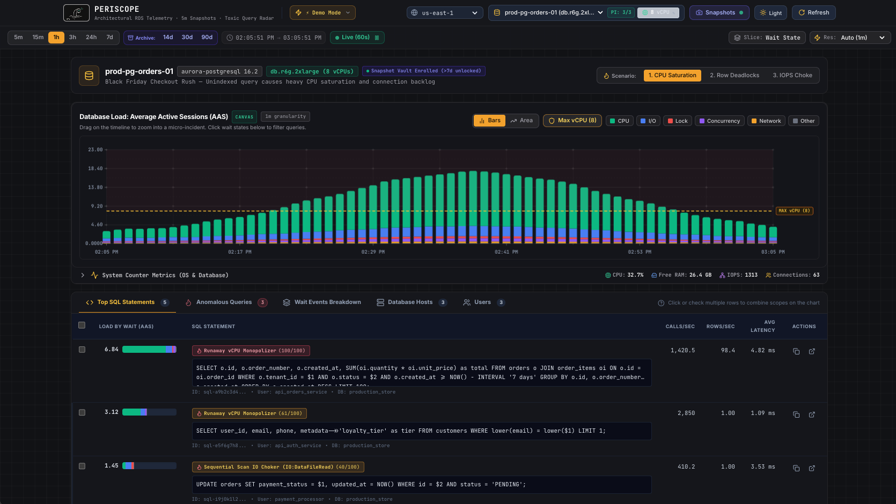

<p align="center">
  <picture>
    <source media="(prefers-color-scheme: dark)" srcset="public/logo-dark.png">
    <source media="(prefers-color-scheme: light)" srcset="public/logo-light.png">
    
  </picture>
</p>

<h1 align="center">Periscope</h1>

<p align="center">
  <strong>Sub-second RDS Performance Insights, 5-minute selective snapshot vault & autonomous toxic query detection.</strong>
</p>

<p align="center">
  <a href="#key-features"></a>
  <a href="#autonomous-toxic-query-radar"></a>
  <a href="#test-suite"></a>
  <a href="#license"></a>
</p>

---

<p align="center">
  <picture>
    <source media="(prefers-color-scheme: dark)" srcset="images/demo_dark.png">
    <source media="(prefers-color-scheme: light)" srcset="images/demo_light.png">
    
  </picture>
</p>

---

## 🔭 Why Periscope?

Amazon CloudWatch Database Insights provides Average Active Sessions (AAS) diagnostics for RDS and Aurora. Periscope uses the existing Performance Insights APIs to add an incident view and a self-hosted history of selected metrics.

1. **Longer AWS-managed history**: Database Insights Standard includes up to seven days of detailed metrics at no additional retention charge and offers paid retention from 1 to 24 months. [AWS CloudWatch pricing](https://aws.amazon.com/cloudwatch/pricing/)
2. **Selective local history**: Periscope lets you choose which databases to snapshot and how long to keep their telemetry in SQLite.
3. **Aggressive Downsampling & Lag**: Standard AWS console charts downsample micro-spikes. When an outage occurs for 45 seconds, the console often rounds it away into 1-minute or 5-minute smoothed averages.
4. **No Actionable Remediation**: AWS shows you that a query is pegging CPU or waiting on `IO:DataFileRead`, but leaves you to diagnose execution plans, temporary file bloat, and index creation.

**Periscope solves this:**
- ⚡ **1-Second Micro-Incident Zoom**: Inspect true real-time spikes without downsampling loss.
- 💾 **Periscope Snapshot Vault**: A background process that captures telemetry for selected databases at five-minute intervals and stores it locally in SQLite.
- 🛡️ **Autonomous Toxic Query Radar**: Flags IO chokers, row lock deadlocks, and memory buffer bloat with copy-pasteable, zero-downtime remediation DDLs (`CREATE INDEX CONCURRENTLY`).
- 🎨 **Architectural Drawing-Board Aesthetic**: A precision-crafted UI in both Dark and Light modes featuring interactive hover legends, execution latency metrics, and smooth docking transitions.

---

## ✨ Key Features

### 📊 True Average Active Sessions (AAS) & Wait Breakdown
Decomposes database workload across 6 standard dimensions:
- **CPU**: Active computation threads (`CPU`).
- **Disk I/O**: Sequential reads, temp table writes (`IO:DataFileRead`, `IO:BufFileRead`).
- **Lock Contention**: Row-level locks, transaction deadlocks (`Lock:transaction`, `Lock:tuple`).
- **Buffer Concurrency**: Lightweight buffer locks, relation extensions (`Buffer:content`, `LWLock:LockManager`).
- **Client & Network**: Slow clients, synchronous socket reads (`Client:ClientRead`).
- **Other**: Background vacuuming, checkpoint flushes.

### 📈 Console-Aligned Query Metrics
Top SQL table populates metrics matching the native AWS PI engine:
- **Calls/sec**: Frequency of execution across microservices.
- **Rows/sec**: Volume of data scanned and returned.
- **Avg Latency (ms)**: Real-time execution duration per call.
- **Wait Breakdown Bars**: Visual representation of the exact wait event share for each SQL digest.

### 🛡️ Autonomous Toxic Query Radar
Periscope continuously analyzes query performance metrics and flags toxic query archetypes:
| Anomaly Archetype | Root Cause | Impact | Automated Remediation |
|---|---|---|---|
| **IO_CHOKER** | High `IO:DataFileRead` + low call count | Disk thrashing, cache eviction | Zero-downtime composite B-tree index |
| **CPU_MONOPOLIZER** | High AAS CPU load exceeding instance vCPUs | Compute exhaustion, queue backlog | Query rewrite, limit pushdown |
| **LOCK_CONVOY** | Heavy `Lock:transaction` or `Lock:tuple` | Serialized thread queues, 504 gateway timeouts | Explicit isolation calibration & row lock batching |
| **BUFFER_BLOAT** | Spilling to disk temp tables (`IO:BufFileRead`) | Memory pressure, shared buffer churn | `work_mem` adjustment & targeted index ordering |

### 💾 Periscope Snapshot Vault (Time Travel >7 Days)
- Selectively onboard specific databases without estate-wide cost inflation.
- Run the autonomous daemon (`periscope daemon --interval 300`) to record 5-minute delta snapshots.
- Travel back across **14-day, 30-day, or 90-day** historical windows seamlessly.

---

## Database Insights pricing and snapshot costs

AWS migrated Performance Insights users to CloudWatch Database Insights on July 31, 2026. The existing Performance Insights APIs still provide access to the metrics Periscope collects. [AWS migration documentation](https://docs.aws.amazon.com/AmazonCloudWatch/latest/monitoring/Database-Insights.html) · [AWS CloudWatch pricing](https://aws.amazon.com/cloudwatch/pricing/)

- **Standard mode** includes up to seven days of detailed metrics at no additional retention charge. For 1–24 months of paid retention, the hourly rate combines a first-month rate with an additional rate for each extra month configured. AWS bills provisioned instances per vCPU-hour and Aurora Serverless and Limitless per ACU-hour. Rates vary by Region. [AWS CloudWatch pricing](https://aws.amazon.com/cloudwatch/pricing/)
- **Advanced mode** charges for monitored capacity and includes retention in the mode price. AWS's US East (N. Virginia) example uses **$0.0125 per vCPU-hour** for provisioned instances and **$0.003125 per ACU-hour** for Aurora Serverless. [AWS CloudWatch pricing](https://aws.amazon.com/cloudwatch/pricing/) · [Database Insights documentation](https://docs.aws.amazon.com/AmazonCloudWatch/latest/monitoring/Database-Insights.html)

For an always-on fleet with 64 provisioned vCPUs in US East (N. Virginia), AWS's published example rates imply about **$1,248/year for Standard with three months of retention** (`64 × 8,760 × ($0.002054 + 2 × $0.000086)`) and **$7,008/year for Advanced mode** (`64 × 8,760 × $0.0125`). These estimates cover the respective Database Insights charges. CloudWatch Logs and API overages are billed separately. AWS includes up to one million Performance Insights API calls per month. [AWS CloudWatch pricing](https://aws.amazon.com/cloudwatch/pricing/)

Periscope stores selected snapshots in SQLite and can run with the seven-day Standard retention setting. Its operating cost depends on the host, disk, backups, and API usage. The vault's history covers the metrics Periscope collects at each capture.

The current Periscope cost estimates use a fixed Advanced mode rate and simplified storage assumptions. Use the AWS rates for your Region, mode, and retention period when budgeting.

---

## 🚀 Quick Start

### 1. Prerequisites
- **Node.js**: v20.0.0 or higher
- **AWS Credentials**: Standard profile configured in `~/.aws/credentials` or IAM environment variables (`AWS_ACCESS_KEY_ID`, `AWS_SECRET_ACCESS_KEY`, `AWS_REGION`).

### 2. Installation
```bash
# Clone the repository
git clone https://github.com/mohit-k-s/Periscope.git
cd Periscope

# Install dependencies
npm install

# Build client and server
npm run build
```

### 3. Launch Periscope
```bash
# Start development mode (Express server on 3001, Vite dev server on 5173)
npm run dev

# Or launch production web service
npm start
```

Visit **`http://localhost:5173`** (or `http://localhost:3001` in production mode).

---

## ⚡ Exploration & Demo Mode

Periscope includes built-in high-fidelity incident presets for development, onboarding tutorials, and testing without requiring live AWS credentials:
- **`prod-pg-orders-01`**: CPU saturation spike during high-concurrency checkout rush.
- **`prod-pg-inventory-02`**: Row-lock contention across concurrent microservices.
- **`analytics-mysql-dw`**: Disk I/O exhaustion caused by unindexed temp-table sorting.

Toggle between **Demo Mode** and **Live AWS** instantly from the header badge or via the **AWS Switch Role & Authentication** modal.

---

## 💻 CLI Reference

Periscope includes a full-featured CLI for CI/CD pipelines, cron jobs, and terminal-first administration:

```bash
periscope <command> [options]
```

| Command | Description | Example |
|---|---|---|
| `run` | Execute a single snapshot cycle across onboarded databases | `npx periscope run` |
| `daemon` | Start the persistent 5-minute recording background loop | `npx periscope daemon --interval 300` |
| `onboard` | Enroll an RDS instance into snapshotting with custom retention | `npx periscope onboard prod-orders-db --retention 30` |
| `offboard` | Remove a database from automated snapshotting | `npx periscope offboard prod-orders-db` |
| `onboarded` | List currently enrolled database targets and their status | `npx periscope onboarded` |
| `list` | Display stored snapshot spans and database sizes | `npx periscope list` |
| `inspect` | View recent snapshots, wait events, and AAS points in terminal | `npx periscope inspect --instance prod-orders-db --hours 24` |
| `anomalies` | Scan stored telemetry for toxic queries and print remediation DDL | `npx periscope anomalies --instance prod-orders-db` |
| `cost` | Run the fixed-rate estimate described in [Database Insights pricing and snapshot costs](#database-insights-pricing-and-snapshot-costs) | `npm run periscope:cost -- --instances 12 --vcpus 96` |
| `export` | Export snapshot database telemetry to a standalone JSON file | `npx periscope export --instance prod-orders-db --out dump.json` |

---

## 🔐 Minimum IAM Permissions

To run Periscope in live AWS environments with read-only permissions, attach this IAM policy:

```json
{
  "Version": "2012-10-17",
  "Statement": [
    {
      "Sid": "PeriscopeRdsDiscovery",
      "Effect": "Allow",
      "Action": [
        "rds:DescribeDBInstances",
        "rds:ListTagsForResource"
      ],
      "Resource": "*"
    },
    {
      "Sid": "PeriscopePerformanceInsightsRead",
      "Effect": "Allow",
      "Action": [
        "pi:GetResourceMetrics",
        "pi:DescribeDimensionKeys",
        "pi:GetDimensionKeyDetails",
        "pi:ListAvailableResourceMetrics"
      ],
      "Resource": "arn:aws:pi:*:*:metrics/rds/*"
    }
  ]
}
```

Cross-account role assumptions (`sts:AssumeRole`) are fully supported directly from the UI or CLI with optional External ID verification.

---

## 🧪 Testing & Verification

Periscope has a comprehensive behavioral test suite verifying domain logic, granularity calculation, anomaly detection, SQLite storage transactions, and AWS SDK fallbacks:

```bash
# Run all 73 behavioral tests
npm test

# Production build verification
npm run build
```

---

## 📄 License

MIT License.
